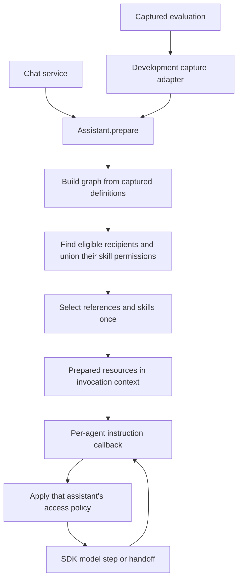

# ChatTFT decision workflow implementation report

The implementation aligns ChatTFT's investigation instructions with the player's question, adds precise item constraints on a single unit copy, and integrates skill eligibility and candidate filtering into the current assistant runtime. It retains the existing three skills and assistant graph. The result is committed as `96e733bead90a5fc3188d83a742cb7643836d2e4` on `codex/decision-workflows-asst-runtime`, directly above `origin/asst-runtime` at `2cef65790821403fd8404f3099ac0b50fcdc7196`.

This report covers the original implementation, the comparison with local and remote `asst-runtime`, and the adaptation onto the remote branch. The final implementation changes 37 files: 1,633 insertions and 466 deletions. Those counts exclude this report. The implementation was committed with a clean working tree and was not pushed.

The combined integration run passed **378 tests**, with **six existing evaluation failures** remaining. This establishes deterministic runtime, query, and contract behavior for the tested paths. It does not establish improved answer quality, fewer model calls, or faster production responses; those require a controlled model-backed comparison.

## What changed for a player

The revised prompts guide a quick frequency question toward a concise answer with the relevant item and its count. They direct a third-item comparison to retain the two fixed items, the holder, and the requested star level. They allow a composition question to explore the relevant alternatives without an arbitrary three-or-four-unit quota. They also permit an inconclusive or suppressed comparison to end with that result instead of manufacturing a winner or broadening the conditions silently. These are the intended answer behaviors; a live comparison has not yet established their frequency in practice.

These behaviors have two different enforcement levels. The database compiler enforces the new item predicates, and runtime code enforces skill access. Prompts and selected skills guide query choice, stopping, and interpretation; they do not turn model judgment into a deterministic rule.

## Assessment of the two analyses

The inputs were [skill-structure-brainstorming.pdf](/home/oliverjdlopez/tft-apps/tft-chat/dev/skill-structure-brainstorming.pdf) and [skill-structure-brainstorming2.pdf](/home/oliverjdlopez/tft-apps/tft-chat/dev/skill-structure-brainstorming2.pdf). Their proposals were assessed against the repository rather than treated as instructions or accepted architecture.

The first analysis made the strongest case for organizing an investigation around the uncertainty blocking a useful answer. Its concrete findings matched several prompt problems: ranking-oriented routing could substitute an easy statistic for the actual question; itemization required a three-delta sweep; report templates imposed unnecessary breadth; and a universal “500 boards is solid” label overstated what sample size establishes. Its distinction between achieved final boards and earlier player decisions became a central interpretation boundary.

The second analysis usefully argued for enforcing comparison semantics in code. However, a substantial part of its proposed comparison wrapper already existed in `compare_cohorts(target, baseline, shared)`, including complement comparisons, overlap reporting, suppression, and eligible lobby-clustered intervals. The concrete missing capability was binding multiple equipped-item requirements to the same unit occurrence as its star and completed-item count.

Some proposals needed stronger evidence. Overlapping intervals do not demonstrate equivalence. Conditioning on final level does not identify the causal value of an earlier roll or level decision. Illustrative HP or timing thresholds cannot become recommendations from final-board aggregates alone. A mandatory confounder sweep could also reproduce the unnecessary-query problem.

| Alternative considered | Decision |
| --- | --- |
| Prompt cleanup alone | Keep the cleanup, but also close the same-copy query gap and integrate resource preparation. |
| A deeper skill taxonomy | Retain the three flat skill identities. A hierarchy would add routing without resolving the concrete comparison problem. |
| A new item or shared-shell comparison tool | Extend `UnitCondition` inside the existing cohort tools; reuse their statistics and reporting contracts. |
| A persistent investigation record or planner and critic graph | Defer. Existing run history and evidence infrastructure already carry the required information; extra orchestration was not justified by measured behavior. |
| Worked-example retrieval or learned skills | Defer until curated traces and repeated behavioral evaluation justify the maintenance and context cost. |
| Automatic validation queries or full delta sweeps | Replace with follow-ups that resolve a material uncertainty or could change the answer. |
| A separate instruction assembler after adopting the new runtime | Use the runtime already supplied by `asst-runtime`; adapt skill eligibility and selection there. |

The analyses' cited research and examples were not treated as proof that this implementation improves ChatTFT. The chosen changes address observable code and prompt problems, while the new evaluation cases provide a way to test the broader behavioral hypothesis.

## Assistant prompts and the three skills

The main `chat` prompt now distinguishes a direct lookup from an investigation requiring a conditional cohort, an explicit comparison, or several pieces of evidence. It preserves the requested population, constraints, metric, and format. After analytical tool use, the existing final responder remains responsible for the supported evidence display and final answer. Greetings and suitable non-statistical questions can still be answered directly.

The analyst prompt describes an investigation protocol: identify the question, select the population and comparator, choose the relevant metric and row grain, and make each additional query earn its place. Brief progress text explains what a query will resolve without exposing private reasoning or drafting the answer prematurely. Name resolution batches newly introduced entity names and reuses their exact stored names within the invocation.

The analyst distinguishes ranking conditions from board-cohort conditions. It explains holder binding, comparable denominators, frequency versus performance, delta baselines, overlap, pagination, and suppression. It uses the existing `rank_unit_loadouts` filters `item_1`, `item_2`, and `item_count=3` when they answer a fixed-two-item third-slot question. No ranking-tool implementation was added for that case; the change teaches the assistants to use existing functionality accurately.

The final responder's long response templates, fixed row quota, and hypothetical statistical examples were replaced with concise synthesis instructions. It answers the original question, includes enough population and sample context to interpret the claim, and identifies a material unresolved boundary. Its evidence-display contract is retained: invocation-local references, at most eight table fields, supported table or distribution types, and a prose fallback when a valid display is unavailable.

The composition and unit experts now cover the dimensions relevant to the request instead of requiring an exhaustive report. The unit expert's description also drops its fixed shortlist quota. Both preserve final-board evidence limits and the distinction between board-level item copy counts and item copies on one unit. The item expert receives a targeted correction for third-slot loadout comparisons. The skill selector is instructed to avoid redundant playbooks and unnecessary investigation guidance on straightforward lookups.

| Existing skill retained | Revised responsibility |
| --- | --- |
| `tft-statistical-investigation` | Define the decision or factual question, population, comparator, metric, interpretation risk, and conditions for a useful follow-up. Explain how to keep same-copy constraints together. |
| `tft-statistical-interpretation` | Interpret samples, denominators, baselines, warnings, uncertainty, and evidence limits. Distinguish association from causation and an unresolved difference from equivalence. |
| `tft-unit-itemization` | Select holder, frequency, outcome, exact-loadout, or conditional evidence according to the itemization question. Remove the mandatory three-delta sweep. Use roles and mechanics only when supported by supplied context. |

Skills remain complete, selectively loaded procedures. Game mechanics remain factual reference material, and durable role behavior remains in assistant prompts. The implementation adds no skill identities, skill hierarchy, specialist agents, or extra mandatory model calls.

The interpretation guidance also makes several specific corrections. Item `holds` count instances, while `boards` count distinct-board outcomes; holds are not the denominator for board placement. An item-holder ranking delta does not automatically compare that holder's alternative items. A large sample does not by itself establish a reliable comparison. Final-board data cannot establish component availability, acquisition order, slam timing, roll timing, or the optimal action in a particular live game.

## Precise item conditions on one unit copy

The query change adds `required_items` and `excluded_items` to `UnitCondition`, which is used by the existing structured cohort filters. The fields constrain the same unit occurrence as the condition's unit name, star level, and completed-item count.

The motivating failure case is a board containing two copies of the same champion. One copy can satisfy a unit star or item-count condition while the other copy carries the requested item. Separate `UnitCondition` and `ItemCondition` entries correctly describe board membership, but their conjunction does not require those facts to belong to the same copy. That is insufficient for a claim about one exact loadout.

| Property | Implemented behavior |
| --- | --- |
| Item names | Exact stored names obtained through the existing name-resolution path. |
| Omitted fields | No additional equipped-item restriction. |
| List size | Each supplied list must contain one to three names. |
| Repeated required names | Require that multiplicity on the same unit copy. Two occurrences of a name require two equipped copies. |
| Excluded names | Require zero instances on that unit copy; duplicate exclusions are rejected. |
| Contradictions | A name cannot be both required and excluded in one condition. |
| Query bounds | Nested item names count toward the existing 64-predicate filter budget. |
| Unit copy bounds | Continue to count unit occurrences satisfying the complete condition. A zero-to-zero range can express absence of a matching item-bearing copy. |

The compiler uses a correlated scalar item count bound by the existing internal `(scope_id, board_key, unit_idx)` occurrence key. Required items compare that count with the required multiplicity; excluded items require zero. These identifiers remain internal. The query still returns aggregate board facts and uses the existing scope, suppression, overlap, and uncertainty paths.

For an explicit third-item comparison, each target and baseline `UnitCondition` must contain all attributes that refer to one copy: the holder, star, completed-item count, both fixed items, and the candidate inclusion or exclusion. Only board-shell and level conditions belong in `shared` for this purpose. Putting a holder condition in `shared` and the candidate item on a separate unit condition does not bind them to one occurrence.

Per-copy exclusions do not make the resulting board cohorts disjoint. A board containing one qualifying A copy and another qualifying B copy can belong to both cohorts. The existing overlap report remains authoritative. The implementation adds no schema migration, public identifiers, raw-row access, ingestion, or changed sample floor.

## Runtime integration and actual execution paths

The final version uses the `Assistant` execution architecture introduced by the remote `asst-runtime` branch. That architecture was inherited, not authored by this workflow change. The new work extends its recipient eligibility and selector candidate filtering, then tests those changes through its normal execution paths.



In chat, `services/chat_service.py::stream_chat` constructs the SDK `Assistant` subclass through `from_name`; `domain.runtime.execution` gathers context and owns Runner dispatch and stream cleanup. The service retains browser formatting and fallback policy. In evaluations, `evals/worker.py::run_assistant` dispatches through `run_captured`; `evals/assistant_execution.py::execute_captured` uses `dev.assistants` to restore the graph, apply prompt candidates, and attach recording to the SDK agent before execution with fresh context. Both use the same assistant classes and resource policy.

`Assistant.prepare` traverses the graph it has actually built from its private definition snapshot. It selects skills from the union of reachable eligible recipients' allowlists. If any eligible recipient has unrestricted access, the discoverable pool remains available. Otherwise the provider receives the bounded name union, preventing unreachable or disallowed skills from taking selector slots. Each assistant's rendering boundary applies its own permissions again.

| Assistant policy | Skill behavior |
| --- | --- |
| Named `chat` assistant | Never receives skill bodies, including when its spec declares an allowlist. |
| Non-chat assistant with repository context and omitted skill list | Eligible for any selected discoverable skill. |
| Non-chat assistant with a nonempty explicit skill list | Eligible for those skills, even if factual repository context is disabled. |
| Explicit empty skill list | Receives no skills. |
| Context-disabled assistant with an omitted skill list | Skips skill injection; this preserves the transcript-only default. |
| Shipped `final_responder` | Permits only `tft-statistical-interpretation`, when selected. |
| A directly invoked analyst or other eligible root | Follows the same eligibility rules as a handoff target. |

The distinction between selection and rendering matters: being eligible does not guarantee that a skill is selected. In the shipped graph, tests supply all three selected skills and verify that the analyst can render all three, chat renders none, and the final responder renders only interpretation.

The inherited runtime continues to preserve immutable definition snapshots, model and selector configuration, task wrappers, invocation-local evidence, activity hooks, and execution provenance. Selection uses unwrapped user input under the existing follow-up heuristic; the SDK receives copied input with any root task wrapper applied. Only the root receives the optional caller system prefix. Rendering is synchronous and does not select resources again.

Captured prompt candidates replace the durable base prompt without discarding the task wrapper, dynamic resources, access policy, or frozen graph. An explicitly empty candidate remains empty rather than reverting to a truthy fallback. These contracts already existed on the new base where applicable and are retained and exercised by the integration tests.

## Original implementation and branch reconciliation

The first implementation was developed against `324b9df`. It was preserved as `300241bc92f8dda0938ca82fe9a59270229760fb` on `codex/decision-workflows-original`, changing 40 files. Its prompts, three revised skills, occurrence-bound item filters, evaluation seed, and supporting tests formed the basis of the final port.

On that older base, the implementation also introduced `domain/assistants/instructions.py::prepare_assistant_instructions` and `PreparedInstructions`. The helper selected references and skills once, walked reachable assistant definitions, and produced an instruction map with per-target base overrides. Chat and the evaluation worker called the shared helper; evaluations also received invocation-local evidence and performed selection and execution in one event loop. Focused preparation tests covered the shared assembly behavior.

The branch comparison found local `asst-runtime` at `4218605` and the remote branch at `2cef657`, with local 11 commits behind remote. The remote revision had already replaced the older construction and evaluation seams with `Assistant`, captured definitions, typed invocation state, and dynamic callbacks. Applying the original runtime patch mechanically would have conflicted with that work and risked restoring retired APIs.

The final implementation therefore preserves the old work as a backup and ports its behavior onto the remote runtime. It does not restore the old `instructions.py`, `PreparedInstructions`, `create_assistant` path, or `eval_graph_instructions` adapter. Runtime regression coverage moves into the existing `tests/test_assistant_runtime.py`. The cohort implementation is retained; prompts and documentation are reconciled with the remote branch's holder semantics, evidence transport, task handling, and evaluation contracts.

The final branch is one commit directly above the remote revision verified during integration. The separate local `asst-runtime` checkout and its three untracked runtime tests were left untouched. Neither `asst-runtime` branch was rewritten, and no remote push was performed.

The final port also preserves an important explicit-permission case: an assistant without factual context can still opt into named skills. A broader context-only gate initially conflicted with an existing access test; the completed implementation permits this explicit opt-in and retains the original access test.

## Evaluation cases and registration

The implementation adds the schema-v3 `decision_workflows` suite, with dataset name `decision-workflows`, eight cases, a 12-turn maximum, and native `answer_quality` requirements. Each case has a quality threshold of 0.8 and is marked `gold_unverified`. The scenarios do not claim that the named entities, constrained samples, or particular outcomes are available in the active data scope.

| Case | What the answer must establish |
| --- | --- |
| Quick frequency lookup | Identify Bard's most common held item only when supported; include the available denominator and keep popularity distinct from strength. |
| Fixed-shell third slot | Compare Infinity Edge and Guardbreaker on 2-star Bard while retaining Guinsoo's Rageblade and Giant Slayer; preserve the cohort, sample, and uncertainty context. |
| Artifact dependence | Assess Death's Defiance on Vi without attributing an unmatched build difference to the Artifact; explain which item or board conditions can actually be controlled. |
| Alternative composition discovery | Investigate final boards with 2-star Bard and without 2-star Amumu, considering available alternatives and disclosing result or pagination limits. |
| Audit a surprising result | Check the premise of Solar-heavy versus Adaptor-focused outcomes with 3-star Akali and Camille, instead of rationalizing an unverified claim. |
| Suppressed comparison | Respect suppressed Bard third-item results, retain all specified conditions, and avoid reconstructing hidden values. |
| No clear difference | State when the Akali and Camille package comparison is unresolved; do not infer a tie from overlapping intervals or force a winner. |
| Roll or level evidence ceiling | Explain why final-board aggregates cannot establish the optimal future choice at level 7, 30 gold, and 65 health; identify the missing decision context. |

The cases assess useful answers, preserved constraints, denominator correctness, uncertainty, and evidence limits. They prescribe no fixed tool sequence or exact numerical outcome. In particular, the names “suppressed comparison” and “no clear difference” identify behavioral coverage; they do not certify that the current database will produce those states.

The seed and a content-addressed snapshot are registered locally. The final snapshot ID is `16f624a45fc8a1febf7bdfe53cc90a2555a0e984701a26e6d7c87ea308a9d0b0`. All 14 previous catalog entries remain unchanged, producing 15 entries and 161 total cases rather than 14 entries and 153 cases. The inventory tests preserve the historical authored checks while separately validating the new natural requirements.

The portable seed has no captured assistant graph and its database target is null. Before a live run, the existing export/run workflow must capture the current definitions for every variant and select an explicit evaluation database. A test verifies that a fresh capture with a placeholder `eval_test` target meets the execution contract without connecting to that database. No hosted dataset update or model-backed experiment was performed.

## Verification and remaining limits

The final combined command ran from the worktree's `tft-chat` directory with the existing main-checkout Python environment:

```bash
PYTHONDONTWRITEBYTECODE=1 /home/oliverjdlopez/tft-apps/tft-chat/.venv/bin/python -m pytest -q \
  tests/test_assistant_runtime.py tests/test_assistant_access.py tests/test_assistants.py \
  tests/test_chat_service.py tests/test_task_service.py tests/test_spec_service.py \
  tests/test_workspace_trials.py tests/test_evaluation_assistant.py \
  tests/test_evaluation_selectors.py tests/test_evaluation_catalog.py \
  tests/test_langfuse_execution.py tests/test_agent_workflow_evals.py \
  tests/test_context_service.py tests/test_skill_provider.py \
  tests/test_cohort_loadouts.py tests/test_cohort_facts.py tests/test_openai_tools.py \
  tests/test_ranking_tools.py tests/test_evidence.py tests/test_decision_workflow_suite.py \
  evals/langfuse/tests
```

The result was **378 passed, 6 failed, 3 warnings in 29.80 seconds**. The six failures match the documented migration baseline:

| Existing failure | Scope |
| --- | --- |
| `test_preflight_rejects_stale_tool_and_malformed_regex` | Stale tool-preflight expectation in `tests/test_evaluation_catalog.py`. |
| `test_probability_case_keeps_python_regex_contract` | Four parameterized failures looking up a removed probability case: `5%`, `five percent`, `1 in 20`, and `0.05`. |
| `test_every_assertion_and_threshold_survives_conversion` | Historical `comp-expert` conversion lookup in `evals/langfuse/tests/test_natural_workspace.py`. |

The run includes the real SDK subprocess executing captured handoffs, tools, model configuration, and wrappers against a deterministic local HTTP model. It also covers chat and task services, Specs trials, selectors, evidence, ranking contracts, and the new evaluation suite. Overlapping smaller runs included 42 passing cohort/ranking/schema tests and nine passing tests in the new loadout module; these counts are not additional unique coverage to add to the combined total.

New SQL fixtures establish the difference between legacy board-level matching and same-occurrence matching, repeated required items, duplicate-holder overlap, cross-scope and board-key isolation, zero matching copies, contradictory inputs, list bounds, and the 64-predicate limit. The comparison fixture verifies target count 3, baseline count 4, overlap count 1, and the overlap warning.

Runtime tests establish selection once per invocation, filtering at nested handoffs, direct analytical roots, explicit no-context skill opt-in, chat exclusion, unrestricted versus bounded candidate pools, unused-resource skipping, the shipped three-agent graph, and empty captured prompt candidates. Existing snapshot, isolation, task, evidence, and activity behavior remains covered through the inherited test suite.

Full evaluation catalog validation still exits with `case 'exact_unit' has required gold absent from the corpus`. `git diff --check` passed, all 14 historical catalog entries were compared unchanged, and 39 local documentation links were checked during integration.

The verification has practical limits. No paid model calls, production database queries, ingestion, projection rebuilds, deployment, or frontend changes were part of the implementation. SQL behavior was exercised with anonymous SQLite fixtures; production query performance and PostgreSQL execution of the new predicates were not measured. The small comparison fixture lowers its reportability floor to one board, so it does not add a direct regression at the real 49/50-board boundary. Suppression code itself was unchanged. No controlled before-and-after answer-quality or latency experiment has yet been run.

An earlier dependency command created an ignored `.venv` in this worktree and populated a temporary uv cache. That generated environment was left untouched and was not committed. The final combined verification used the explicit existing interpreter shown above.

## Complete final change inventory

The following inventory accounts for all 37 files in `96e733b`. Each linked path is in the current worktree. The original runtime-only files described earlier exist in the preservation commit, not in this final implementation.

### Assistant definitions

| File | Change |
| --- | --- |
| [chat/system.md](/home/oliverjdlopez/.codex/worktrees/c78c/tft-apps/tft-chat/app/backend/src/domain/assistants/specs/chat/system.md) | Question-oriented routing, economical clarification, name reuse, stopping, and evidence boundaries. |
| [comp_expert/system.md](/home/oliverjdlopez/.codex/worktrees/c78c/tft-apps/tft-chat/app/backend/src/domain/assistants/specs/comp_expert/system.md) | Relevant composition dimensions, same-copy comparisons, dependency limits, and uncertainty. |
| [data_analyst/agent.json](/home/oliverjdlopez/.codex/worktrees/c78c/tft-apps/tft-chat/app/backend/src/domain/assistants/specs/data_analyst/agent.json) | Description reflects investigations beyond direct lookups. |
| [data_analyst/system.md](/home/oliverjdlopez/.codex/worktrees/c78c/tft-apps/tft-chat/app/backend/src/domain/assistants/specs/data_analyst/system.md) | Investigation protocol, tool selection, conditional comparisons, and supported handoff. |
| [final_responder/agent.json](/home/oliverjdlopez/.codex/worktrees/c78c/tft-apps/tft-chat/app/backend/src/domain/assistants/specs/final_responder/agent.json) | Interpretation-only skill allowlist. |
| [final_responder/system.md](/home/oliverjdlopez/.codex/worktrees/c78c/tft-apps/tft-chat/app/backend/src/domain/assistants/specs/final_responder/system.md) | Concise synthesis and evidence display guidance without fixed report quotas. |
| [item_expert/system.md](/home/oliverjdlopez/.codex/worktrees/c78c/tft-apps/tft-chat/app/backend/src/domain/assistants/specs/item_expert/system.md) | Accurate third-slot use of existing loadout filters. |
| [skill_selector/system.md](/home/oliverjdlopez/.codex/worktrees/c78c/tft-apps/tft-chat/app/backend/src/domain/assistants/specs/skill_selector/system.md) | Select procedures that materially help the question; avoid redundant coverage. |
| [unit_expert/agent.json](/home/oliverjdlopez/.codex/worktrees/c78c/tft-apps/tft-chat/app/backend/src/domain/assistants/specs/unit_expert/agent.json) | Removes the fixed shortlist from the description. |
| [unit_expert/system.md](/home/oliverjdlopez/.codex/worktrees/c78c/tft-apps/tft-chat/app/backend/src/domain/assistants/specs/unit_expert/system.md) | Question-specific unit comparisons and accurate item, sample, and evidence limits. |

### Runtime and query code

| File | Change |
| --- | --- |
| [assistants/assistant.py](/home/oliverjdlopez/.codex/worktrees/c78c/tft-apps/tft-chat/app/backend/src/domain/assistants/assistant.py) | Derives eligible recipients and their candidate-name union from the captured graph. |
| [assistants/runtime.py](/home/oliverjdlopez/.codex/worktrees/c78c/tft-apps/tft-chat/app/backend/src/domain/assistants/runtime.py) | Passes bounded candidate names to selection and skips unusable skill work. |
| [assistants/utils.py](/home/oliverjdlopez/.codex/worktrees/c78c/tft-apps/tft-chat/app/backend/src/domain/assistants/utils.py) | Shared eligibility predicate and dynamic per-assistant rendering policy. |
| [db_tools/cohort_tools.py](/home/oliverjdlopez/.codex/worktrees/c78c/tft-apps/tft-chat/app/backend/src/domain/tools/db_tools/cohort_tools.py) | Documents occurrence-bound item behavior in the model-facing tool contract. |
| [db_tools/models.py](/home/oliverjdlopez/.codex/worktrees/c78c/tft-apps/tft-chat/app/backend/src/domain/tools/db_tools/models.py) | New required and excluded item fields with strict validation. |
| [db_tools/utils.py](/home/oliverjdlopez/.codex/worktrees/c78c/tft-apps/tft-chat/app/backend/src/domain/tools/db_tools/utils.py) | Correlated item counts and bounded nested-predicate accounting. |

### Skills

| File | Change |
| --- | --- |
| [Statistical investigation](/home/oliverjdlopez/.codex/worktrees/c78c/tft-apps/tft-chat/app/backend/src/domain/resources/content/skills/tft-statistical-investigation/SKILL.md) | Focused planning, meaningful follow-ups, and same-copy comparison guidance. |
| [Statistical interpretation](/home/oliverjdlopez/.codex/worktrees/c78c/tft-apps/tft-chat/app/backend/src/domain/resources/content/skills/tft-statistical-interpretation/SKILL.md) | Population, denominator, uncertainty, and observational evidence discipline. |
| [Unit itemization](/home/oliverjdlopez/.codex/worktrees/c78c/tft-apps/tft-chat/app/backend/src/domain/resources/content/skills/tft-unit-itemization/SKILL.md) | Conditional tool use, exact loadouts, and context-supported allocation analysis. |

### Evaluation assets and regression tests

| File | Change |
| --- | --- |
| [decision_workflows.json](/home/oliverjdlopez/.codex/worktrees/c78c/tft-apps/tft-chat/evals/datasets/decision_workflows.json) | Portable eight-case seed with natural answer requirements. |
| [Decision workflow snapshot](/home/oliverjdlopez/.codex/worktrees/c78c/tft-apps/tft-chat/evals/langfuse/snapshots/16f624a45fc8a1febf7bdfe53cc90a2555a0e984701a26e6d7c87ea308a9d0b0.json) | Content-addressed local suite registration. |
| [catalog.json](/home/oliverjdlopez/.codex/worktrees/c78c/tft-apps/tft-chat/evals/langfuse/snapshots/catalog.json) | Adds the suite while preserving every previous entry. |
| [test_content.py](/home/oliverjdlopez/.codex/worktrees/c78c/tft-apps/tft-chat/evals/langfuse/tests/test_content.py) | Separates new natural requirements from historical assertion inventory. |
| [test_assistant_runtime.py](/home/oliverjdlopez/.codex/worktrees/c78c/tft-apps/tft-chat/tests/test_assistant_runtime.py) | Runtime eligibility, selection union, direct roots, shipped graph, and captured candidate regressions. |
| [test_assistants.py](/home/oliverjdlopez/.codex/worktrees/c78c/tft-apps/tft-chat/tests/test_assistants.py) | Synchronizes existing prompt-contract assertions and verifies responder access. |
| [test_cohort_loadouts.py](/home/oliverjdlopez/.codex/worktrees/c78c/tft-apps/tft-chat/tests/test_cohort_loadouts.py) | SQL membership, multiplicity, overlap, isolation, validation, and bounds. |
| [test_decision_workflow_suite.py](/home/oliverjdlopez/.codex/worktrees/c78c/tft-apps/tft-chat/tests/test_decision_workflow_suite.py) | Seed and snapshot contracts, authored evidence status, and fresh captured execution compatibility. |
| [test_evaluation_catalog.py](/home/oliverjdlopez/.codex/worktrees/c78c/tft-apps/tft-chat/tests/test_evaluation_catalog.py) | Updates the stale inventory assertion to the actual historical catalog plus the new suite. |
| [test_openai_tools.py](/home/oliverjdlopez/.codex/worktrees/c78c/tft-apps/tft-chat/tests/test_openai_tools.py) | Confirms new nested fields appear in both cohort tool schemas. |

### Documentation

| File | Change |
| --- | --- |
| [Assistants and tasks](/home/oliverjdlopez/.codex/worktrees/c78c/tft-apps/tft-chat/docs/architecture/assistants-and-tasks.md) | Runtime eligibility, direct roots, per-agent rendering, and responder policy. |
| [Decision workflow design](/home/oliverjdlopez/.codex/worktrees/c78c/tft-apps/tft-chat/docs/architecture/decision-workflows.md) | Assessment of both analyses, alternatives, implementation rationale, and limits. |
| [Web runtime](/home/oliverjdlopez/.codex/worktrees/c78c/tft-apps/tft-chat/docs/architecture/web-runtime.md) | Resource selection within the current invocation path. |
| [Skill provider](/home/oliverjdlopez/.codex/worktrees/c78c/tft-apps/tft-chat/docs/content_providers/skills.md) | Procedure boundaries, recipient eligibility, candidate filtering, and rendering. |
| [Decision workflow evaluations](/home/oliverjdlopez/.codex/worktrees/c78c/tft-apps/tft-chat/docs/development/decision-workflows.md) | Case intent, local registration, and requirements before live execution. |
| [Langfuse execution](/home/oliverjdlopez/.codex/worktrees/c78c/tft-apps/tft-chat/docs/development/langfuse-execution.md) | New suite registration and captured execution requirements. |
| [Testing and evaluations](/home/oliverjdlopez/.codex/worktrees/c78c/tft-apps/tft-chat/docs/development/testing-and-evals.md) | Added coverage and the integration validation record. |
| [Query cohorts](/home/oliverjdlopez/.codex/worktrees/c78c/tft-apps/tft-chat/docs/tool_groups/query_cohorts.md) | Required and excluded items, same-copy examples, limits, and overlap semantics. |

## Remaining evaluation work

The next meaningful check is a repeated comparison of old and revised prompts using the same model, captured runtime, data scope, and budgets. Both candidates must use comparable resource preparation; older scores obtained without selected workflows are not a valid direct baseline. Review whether answers retain constraints, use appropriate denominators, expose meaningful uncertainty, and stop when further calls would not improve the answer.

The six existing evaluation failures and missing `exact_unit` corpus gold remain separate maintenance work. PostgreSQL execution and production-scale cost of the added correlated predicates also remain unmeasured. These limits do not negate the deterministic fixes, but they constrain claims about end-to-end improvement and operational performance.
